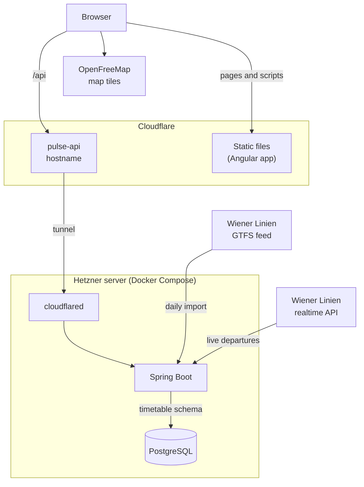

# Vienna Pulse

[](https://github.com/vlad-dancea/vienna-pulse-v2/actions/workflows/backend.yml)
[](https://github.com/vlad-dancea/vienna-pulse-v2/actions/workflows/frontend.yml)

A live map of the Vienna public transport network, built on the Wiener Linien GTFS feed. It shows
the stops, today's lines, the running vehicles where the timetable puts them right now, and a
stop's next departures.

| Folder | What it is |
| --- | --- |
| [`vienna-pulse-backend`](vienna-pulse-backend) | Spring Boot (Java 25): imports the GTFS feed into PostgreSQL every morning and serves stops, scheduled lines and scheduled vehicle positions as GeoJSON, and a stop's next departures with Wiener Linien's live times as JSON |
| [`vienna-pulse-frontend`](vienna-pulse-frontend) | Angular 22 (TypeScript): a full-screen map of Vienna with stops, scheduled routes, the running vehicles and a stop's next departures with their live times |
| [`deploy`](deploy) | The production stack and how it is deployed |

## Architecture



### Frontend

The Angular app is a set of static files, which Cloudflare serves from its edge with Workers
Static Assets. A path that is not a file gets `index.html`, so Angular's router handles it and sends a path it does not know to the map. The
browser loads the base map from OpenFreeMap and everything about the network from the API at
`https://pulse-api.vladdancea.com/api`. The production build sets that origin in
[`environment.ts`](vienna-pulse-frontend/src/environments/environment.ts), and
[`api-origin.ts`](vienna-pulse-frontend/src/app/api-origin.ts) puts it in front of every `/api`
request. The API is another origin than the site, so the backend allows the site and its Previews
to read it with CORS. The map is in [`map-view.ts`](vienna-pulse-frontend/src/app/map-view/map-view.ts).
The API types and the services that load them are in
[`timetable/`](vienna-pulse-frontend/src/app/timetable), which lint keeps free of MapLibre.

[`public/_headers`](vienna-pulse-frontend/public/_headers) sends a Content-Security-Policy that
allows scripts only from the site itself and connections to it, the API and OpenFreeMap, plus the
other security headers. The build adds a rule per hashed JavaScript and CSS file so browsers cache
those for a year.

### Cloudflare Worker

[`wrangler.json`](vienna-pulse-frontend/wrangler.json) deploys the built files as a Worker without
a script, so Cloudflare answers every request on `pulse.vladdancea.com` from those files. Requests
for static files are free and unlimited, while every request that runs Worker code counts against
the Workers Free plan's 100,000 a day. The API has a hostname of its own for the same reason: one
open map polls `/api/vehicles` 5,760 times a day, and `pulse-api.vladdancea.com` has no Worker in
front of it.

### Tunnel and server

The backend runs on one Hetzner server as the Docker Compose stack in
[`deploy/compose.yaml`](deploy/compose.yaml): Spring Boot, PostgreSQL and cloudflared. cloudflared
connects out to Cloudflare, which forwards `/api/*` on `pulse-api.vladdancea.com` to the backend
over that connection, so the server has no open ports to the internet. The database sits on an internal network without
internet access. Administrators and CI reach the server over Tailscale.

### Daily import

At 07:00 Vienna time, [`ImportJob`](vienna-pulse-backend/src/main/java/com/vladdancea/viennapulse/importer/ImportJob.java)
downloads the ZIP file of Wiener Linien's
[GTFS feed](https://www.data.gv.at/datasets/ab4a73b6-1c2d-42e1-b4d9-049e04889cf0?locale=de),
which Stadt Wien publishes under CC BY 4.0, and checks that it has every file the importer needs. It streams
the routes, stops, shapes, trips, stop times, service calendars and their exceptions into a `staging` schema with
PostgreSQL's `COPY`. Then it classifies every platform by the modes of the trips that let
passengers board or alight there, and records when each trip leaves its first stop and reaches
its last. In the same transaction, [`Store`](vienna-pulse-backend/src/main/java/com/vladdancea/viennapulse/importer/store/Store.java)
renames `timetable` to `timetable_old` and `staging` to `timetable`. Readers see either the
previous timetable or the new one, never a mix, and a failed import leaves the previous one in
place. A failed import tries again after 10 minutes, 1 hour and 3 hours, then waits for the next
morning. The download stops at 500 MB.

Every attempt leaves a row in `public.imports`, outside the schema the import replaces: its
outcome, the error of a failure, the feed's size and SHA-256, and the rows loaded into each table.
A success's row commits with its swap. The `timetable` health component on the management port
turns DOWN when the last success is more than 36 hours old or no trip runs tomorrow.
Readiness leaves it out, because an old timetable still beats no API.

Flyway migrations create the tables when the backend starts. A new database gets its first
import right after startup, and so does one where an upgrade added stop modes, stop times or
trip spans that are still empty.

### API

The [`api`](vienna-pulse-backend/src/main/java/com/vladdancea/viennapulse/api) package reads the
`timetable` schema and shares no code with the importer. The feed lists each platform as a stop
of its own, with ids like `at:49:1320:0:3`. The first three parts name the stop, and the API
merges a stop's platforms into one point in their middle, with the id `at:49:1320`, which the
`stops` table stores as `merged_id`. The rules every query follows, which services run on a day,
which days the timetable covers and where a service day's times start, are SQL functions in a
`pulse` schema that imports leave alone. The importer's health check uses them too.

| Endpoint | What it returns |
| --- | --- |
| `/api/stops` | Every stop as a GeoJSON point with its name and the modes that serve it. The modes are null while an upgrade waits for its first classification. |
| `/api/lines?date=YYYY-MM-DD` | The lines that run on the date, today in Vienna if left out, as GeoJSON paths along the shapes their trips follow, with the line's name, mode and colors. A date the timetable does not cover gets a 404. |
| `/api/vehicles` | A GeoJSON point for every trip running at the start of the current five-second step, where its timetable puts it, or its [live delay](#vehicles-at-their-live-times) where the departure board's live times give one, with the trip id as feature id and the line, its colors, the headsign, the delay in seconds and the path it follows for the next 30 seconds as properties. The path is a list of `[longitude, latitude, seconds]` waypoints, and the collection's `time` is the step's start, which the seconds count from. |
| `/api/stops/{id}/departures` | The next two departures of each line and headsign from any platform of the merged stop, soonest first, each with its planned time, its live time if there is one, its line, its headsign, its platform and the code signs show for that platform if the live data has one, and a `liveStatus` for the stop, with `liveIn`, the seconds until the next round, while it is `pending`. Times are in Vienna. An unknown stop gets a 404. |

A vehicle moves along its shape at an even speed between two stops and waits at a stop between
its arrival and departure. The timetable gives whole minutes, so two stops can share one, and the
vehicle is then halfway between them at that minute instead of jumping. Trips without a shape, or without distances along it, are left out. The trip spans
the importer records find the running trips without reading every stop time. A path has a waypoint
wherever the vehicle reaches or leaves a stop or passes a point of its shape, except where the path
passes within a metre anyway. Thirty seconds is two requests of a map, so its vehicles keep moving
when one answer fails or comes late.

Successful responses carry an ETag and `Cache-Control: no-cache`, so a browser asks again each time
and gets an empty 304 while nothing changed. Errors use the problem details format of RFC 9457, and
[`openapi.json`](vienna-pulse-backend/openapi.json) lists the ones each endpoint can answer.

The backend keeps the stops and today's lines, serialized with their ETag, until an import
replaces the timetable, which it notices because every import renames a new schema to `timetable`.
It works out the vehicles once per step for every map. Other days' lines and the departures are
read on each request.

When the database is slow or down, a request that needs it is answered with a 503,
`Cache-Control: no-store` and `Retry-After: 5`. The stops and lines need it on every request to
check the timetable version, and the vehicles once per step. The API waits at most 2 seconds for
a database connection, cancels any query that runs for more than 5 seconds and gives up after 10
seconds on a database that stops answering altogether. Other database errors get a 500.

### Live departures

The [`live`](vienna-pulse-backend/src/main/java/com/vladdancea/viennapulse/live) package adds
live times to the departures from the `monitor` endpoint of Wiener Linien's
[realtime API](https://www.data.gv.at/datasets/cfba4373-a654-3e0b-80f8-348738169f95?locale=de),
whose data Stadt Wien publishes under CC BY 4.0. It answers without a key with every departure of the next 70
minutes from the platforms it is asked about, with a planned time and usually a live one, but
without a trip id or a vehicle position.

The dataset's fair-use rules ask clients to leave at least 15 seconds between requests and to ask
only about the stops someone needs, or Wiener Linien block the client's address. Wiener Linien
publish no other numbers, and a test from one address was blocked with HTTP 403 and code 316
after about 10 requests a minute. So the backend treats the 15 seconds as a limit for the whole
server:

- A departures request opens the stop's station for a minute. The station's number is 60200000
  plus the third part of the stop's id, so `at:49:1320` is 60201320. The stops outside Vienna,
  with ids from `at:43:`, have none.
- A round sends one request for the platforms of every open station, at most 100, and the
  stations that do not fit go first in the next round. With no station open it sends nothing. The
  platforms of each station come from Wiener Linien's
  [list of platforms](https://www.wienerlinien.at/ogd_realtime/doku/ogd/wienerlinien-ogd-haltepunkte.csv),
  which the backend loads at startup and again once a day, or within the hour after a failed load.
- One gate decides when a round may start: 15 seconds after the last request ended, and never
  while one runs. Departures requests and a loop that checks the gate every second take it under
  one lock, so two requests never start within 15 seconds, however many people use the map at
  once, and the backend asks at most 4 times a minute. The gate counts on a clock that only moves
  on, so setting the server's clock cannot shorten the wait, and it stays shut for the first 15
  seconds after a start, in case the process before asked just before it stopped.
- A departures request whose station has no answer from the last minute starts a round itself
  when the gate is open. It sends the round before it reads the timetable and waits for the answer
  after, so the database query hides the wait. A request for a station in a running round waits
  for that round instead, and so does one whose station must wait for the next round, because the
  running round decides when that starts. Each waits at most until the round's timeout, 2 seconds
  after it started.
- After a 403, a 429 or code 316, the gate stays shut for 5 minutes. Any other failure, or no
  answer within 2 seconds, leaves the board with the timetable's times until the next round, so a
  failing realtime API never fails a departures request.
- The requests go through Apache HttpClient with its retries turned off, and follow no redirect,
  since either would make a second request in the same round. Java's own client sends a GET again
  by itself when the connection drops before an answer. Everything else in the backend uses Java's
  client.

With one person on the map, the first answer for a stop already has its live times. A stop
opened within 15 seconds of the last request waits for the next round, because the rules allow
nothing sooner, and its first answer has the planned times only. The `liveStatus` says whether a
later answer will have more:

- `pending`: no round has fetched the station yet. `liveIn` says in how many whole seconds,
  rounded up, the next round may start, and is null for the other two.
- `live`: a round fetched it in the last minute, so a departure without a live time has no live
  data.
- `unavailable`: there is no live data, because the stop has no station or Wiener Linien failed
  or blocked the backend.

An answer more than a minute old, from a station waiting for its turn while many are open, counts
as none.

The live departures carry no trip id, so each is paired with a timetable departure of the same
line and direction whose planned times are at most two minutes apart, the closest first. Wiener
Linien plan some platforms a minute or two later than the timetable, and their U-Bahn times have
half minutes that the timetable rounds either way. Their directions, `H` and `R`, match the
timetable's direction ids on most lines but are the other way round on a few, such as bus 5B, so
each line takes the reading that pairs more of its departures. One request for Stephansplatz,
Karlsplatz, Westbahnhof, Praterstern and Floridsdorf on 2026-10-24 paired 278 of the 279 live
departures of the next hour. The one left was a tram ending at Floridsdorf, which the board does
not list.

A paired departure also gets the code that signs show for its platform, such as `1` or `2` for a
U-Bahn platform or a letter for one of the bus and tram stops at a large station. The codes come
from Wiener Linien's
[list of platform codes](https://www.wienerlinien.at/ogd_realtime/doku/ogd/wienerlinien-ogd-steige.csv),
which has 452 platforms at 170 stations and loads like the list of platforms, but on its own, so a
failed load of the codes leaves the live times alone. The timetable has no codes, and its platform ids have nothing in
common with Wiener Linien's platform numbers, so a departure without a live one has no code. On
2026-10-26, 1,098 of the 1,154 paired departures at the 14 stations with the most codes got one,
and the other 56 left from platforms without a code. Wiener Linien's route file could tie the two
lists by line and next station, but that left 22% of the same departures without a code and put
tram 2 at Schwedenplatz at the stop its route lists instead of the one it left from that day. The
live answers have a `platform` field of their own, which says 1 or 2 at most bus and tram stops,
also where the list has a letter.

A departure planned up to an hour ago stays on the board while its live time is still ahead, and
the two departures shown for each line and headsign are the soonest by live time where there is
one. The live time is what the displays at the stops show, but a delay computed from it can
mislead: during a U3 disruption, Wiener Linien paired a train planned for 20:15 with 21:02 and one
planned for 20:33 with 20:23. The [map view](#map-view) shows the live times in its departure
panel.

Every answer also goes into `public.live_departures`, outside the schema imports replace, for
statistics of how punctual the lines are. A row is one departure, by platform, line, direction and
planned time, with its station, its live time and countdown from the last round that listed it,
when the first and last of those rounds asked, and the trip and route of the timetable departure
it was paired with. Each round updates the rows it lists, so a row ends with the last prediction
before the vehicle left. The view `public.observed_departures` keeps the rows a round listed a
minute or less before their live time, with their delay. The others are predictions from a board
that closed earlier. A round pairs its answer with the timetable that the station's last
departures request read. The first round of a station starts before that request reads it, so it
records the trips only when Wiener Linien answer after the database, and the next round adds them
otherwise. Trains without a planned time, which Wiener Linien put in on top of the timetable, are
left out.

The rows cover only the stations someone opened, while they had them open, because the fair-use
rules allow no other requests, so statistics from them describe those stations and hours, not the
whole network. Recording sends no request of its own and stores nothing about who opened a
station. The first answer for a station adds a row for each of its departures in the next 70
minutes, 66 at Karlsplatz at 23:20 on a Sunday, and each further minute it stays open adds those
that come into that window. The median delay of each line:

```sql
SELECT line, count(*), percentile_cont(0.5) WITHIN GROUP (ORDER BY delay) AS median_delay
FROM public.observed_departures
GROUP BY line
ORDER BY line;
```

#### Vehicles at their live times

The map's vehicles come from the timetable, and the live times move those of the trips they pair
with. Such a trip runs as far behind its timetable as its live time is after its planned time in
the timetable, from the last round that listed it, at the station it leaves first when that round
listed it at several. It keeps that delay for the rest of the trip, also after it left the stations
people opened, since Wiener Linien expect a late vehicle to stay late at its later stops too. The
backend forgets a delay four hours after the last round that listed it, longer than the 70 minutes
ahead that a round lists plus the longest trip of the timetable, 150 minutes, and shorter than the
day until the trip runs again.

Delays from 5 minutes early to 20 minutes late count. Among the 1,686 paired departures that
production recorded by 2026-10-26, Wiener Linien expected none more than 185 seconds before they
planned it, 95 in 100 at most 188 seconds late and a few up to 11 minutes late, but buses 78A
planned that morning up to two and a quarter hours late. During a U3 disruption they paired trains
with live times 47 minutes later and 10 minutes earlier. Their own planned times differ from the
timetable's by up to two minutes, which the bounds allow for. A live time outside them sends its
trip back to the timetable.

A vehicle never jumps or turns back when its delay appears or changes. Maps move the vehicles along
the paths of the last answer they have, so its delay starts changing only when those 30 seconds
are over, 35 seconds after the round, and then by half a second each second until it is the
trip's. Meanwhile the vehicle moves at half its timetable speed while it falls behind, or at one
and a half times while it catches up, so a delay of two minutes takes four. The vehicles' `delay`
is how far behind its timetable the vehicle runs at the start of its path, negative when ahead,
and null for the vehicles that the timetable alone places. The map draws both the same.

Working out the vehicles reads the delays that the rounds already have, so it opens no station,
sends Wiener Linien nothing and still happens once per step for every map.

`mise run dev` asks Wiener Linien too, within the same limits. The tests never do: they answer
from [`MonitorServer`](vienna-pulse-backend/src/test/java/com/vladdancea/viennapulse/live/MonitorServer.java),
which replays an answer Wiener Linien sent.

## Run

The toolchain is managed by [mise](https://mise.jdx.dev): the root `mise.toml` pins the tool
versions for every project, and each project's `mise.toml` defines its own tasks. The backend
also needs [Docker](https://docs.docker.com/engine/install/): it starts its PostgreSQL database in
a container, and its tests start their own.

```bash
mise trust --all
mise run dev     # backend at http://localhost:8080, frontend at http://localhost:4200
mise run check   # the lint and the check task of every project, which CI runs too
mise run format  # format the sources of every project
mise run openapi # update the API description and the frontend types made from it
```

mise installs the pinned tools on first use. The frontend installs dependencies from its
committed pnpm lockfile before its tasks run. In development, the Angular dev server forwards
`/api` to the backend on port 8080.

To run one project, use `mise run //vienna-pulse-frontend:dev` or
`mise run //vienna-pulse-backend:dev`. Each project has its own CI workflow running its
`check` task. The backend checks formatting, compiler warnings, Error Prone, NullAway and its
tests. The frontend checks formatting, its generated API types, typed ESLint rules, template
accessibility, the production build, Vitest tests, Cloudflare runtime integration tests and a
Playwright test that opens the built map in headless Chromium. The backend's CI workflow also
packages the jar and builds the container image, which the local check does not.
A third workflow runs `mise run lint` on the files that belong to neither project: actionlint
and zizmor check the workflows, and shellcheck checks the deploy scripts and mise file tasks.
In CI, zizmor also runs its online audits, which look up the pinned actions on GitHub. Run
`GH_TOKEN=$(gh auth token) mise run lint` to include them locally.

The backend's `openapi.json` describes what the API answers. A backend test fails when the
controllers serve anything else, and the frontend generates its API types from the file, so a
renamed or removed field fails a check in the pull request that makes it. springdoc cannot see the
errors, which the services throw, so
[`ErrorResponses`](vienna-pulse-backend/src/test/java/com/vladdancea/viennapulse/api/ErrorResponses.java)
in the tests lists them, and a new error needs a line there.

[`AGENTS.md`](AGENTS.md) holds the instructions for coding agents, and `CLAUDE.md` points Claude
Code to it. `.mcp.json` and `.codex/config.toml` start the Angular CLI's MCP server for Claude
Code and Codex with the project's pinned CLI. Install its dependencies first with
`mise run //vienna-pulse-frontend:install`.

## Map view

The frontend shows Vienna's public transport stops, today's scheduled routes and the running
vehicles on a full-screen map. [MapLibre GL JS](https://maplibre.org) draws the map with
[OpenFreeMap](https://openfreemap.org)'s light Positron style, which needs no API key. Stops come
from `/api/stops` and routes from `/api/lines`, using today's service date in Vienna. The date
updates within a minute of midnight and when a suspended tab resumes. Lines use the feed's colors,
with fallback colors when none are supplied, and show their names at closer zoom levels.

Vehicles come from `/api/vehicles` every 15 seconds while the tab is visible, and again as soon
as it becomes visible. Each one is a dot in its line's color that follows the path the API sends
for it, along its route and at its timetable's pace, from the first answer on. Each answer covers
30 seconds and continues where the vehicles are, so they keep moving when one request fails or
comes late. When the paths have run out, such as in a tab hidden for a while, the vehicles jump to
where the next answer puts them. With reduced motion turned on, they jump to where they are with
every answer instead. The positions come from the timetable, set back or ahead by the live delay
for the trips the departure board's rounds paired (see [Vehicles at their live times](#vehicles-at-their-live-times)).

The All, U-Bahn, Tram and Bus controls filter routes, vehicles and stops. Interchanges remain
visible for every mode that serves them. Stop modes cover the full imported timetable, while
routes run on today's service date. Stop loading and upgrade status appear in the map panel only
while needed, with a retry button when the stops request fails. The lines keep the last ones that
loaded while a new day loads or a request fails, and a failed request is retried once a minute.
With no lines on the map the panel says they could not be loaded and offers a retry, and on a date
the timetable does not cover it says there is no timetable for today. The panel also says when the
base map style could not be loaded. While the backend is upgrading or
importing for the first time, the frontend keeps available stops visible and rechecks once a
minute until classifications arrive. The map keeps MapLibre's own mouse, touch and keyboard
controls.

Clicking a stop opens its departures beside the map, or in a sheet over the lower half of the map
on phones, and puts the stop in the URL as `?stop=at:49:1320`, so a link opens it. The panel lists
the next two departures of each line and headsign in the next hour, like the displays at the
stops, sorted by mode and line, and only for the mode the filter shows. Each departure shows the
minutes until it leaves and its clock time, both from Wiener Linien's live time where there is one
and from the timetable otherwise. A green signal marks the live times. When the live time is a
minute or more away from the planned one, the planned time appears struck through beside it, and
screen readers hear "planned" and "expected" instead. From 3 minutes late the live time is red.
The panel refreshes every 30 seconds while the tab is visible, and at once when it becomes visible.
When the backend asked Wiener Linien in the last 15 seconds, the first answer for a stop it has not
fetched recently has planned times only, so each time shows a loader. The panel asks again when
that answer's `liveIn` says the next round may start, because a request that arrives then starts
the round or joins it and waits for its answer (see [Live departures](#live-departures)). While a
round outlasts its 2 second timeout, `liveIn` can fall a little short, and the panel gets one more
`pending` answer first. Without `liveIn`, and after a refresh that failed while the live times were
pending, it asks every 15 seconds instead of 30.
The map's attribution credits the timetable as "Fahrplandaten: Wiener Linien" and the live times as
"Echtzeitdaten: Wiener Linien", as their CC BY 4.0 licenses ask. Stadt Wien publishes both, and its
[open data terms](https://digitales.wien.gv.at/ogd-nutzungsbedingungen/) ask for the credit
"Datenquelle: Stadt Wien – data.wien.gv.at" word for word. The district boundaries' credit starts
with it, and MapLibre drops a credit that a longer one contains, so it appears on its own only when
the map is zoomed out past the boundaries.

Vienna's 23 Bezirke have dashed boundaries and numbered names, replacing the base map's
neighborhood labels inside and outside the city. Street, town and village names stay
visible above the boundaries. District names appear from zoom 12 and fade out between
zoom 14 and 15. Wider views show district numbers. The bundled geometry comes from
[Stadt Wien's district boundaries](https://www.data.gv.at/katalog/dataset/2ee6b8bf-6292-413c-bb8b-bd22dbb2ad4b/resource/f5ad0704-ceca-4c46-87f2-f2e131eee44b)
under [CC BY 4.0](https://creativecommons.org/licenses/by/4.0/).
Datenquelle: Stadt Wien – data.wien.gv.at.

The snapshot was downloaded on 2026-10-20, with source update date 2026-09-01. It is
simplified to a 5-meter interval and coordinates rounded to five decimal places. Label
anchors are interior points of the simplified polygons. To refresh both assets from the
repository root:

```sh
district_tmp=$(mktemp -d)
curl --fail --location 'https://data.wien.gv.at/daten/geo?service=WFS&request=GetFeature&version=1.1.0&typeName=ogdwien:BEZIRKSGRENZEOGD&srsName=EPSG:4326&outputFormat=json' -o "$district_tmp/districts.json"
mise exec -- pnpm dlx mapshaper@0.7.36 \
  -i "$district_tmp/districts.json" \
  -filter-fields BEZNR,NAMEK -rename-fields number=BEZNR,name=NAMEK \
  -simplify interval=5 keep-shapes \
  -o vienna-pulse-frontend/public/data/vienna-districts.geojson format=geojson precision=0.00001 \
  -points inner \
  -o vienna-pulse-frontend/public/data/vienna-district-labels.geojson format=geojson precision=0.00001
rm -r "$district_tmp"
```

## Deployment

The frontend runs at [pulse.vladdancea.com](https://pulse.vladdancea.com) on Cloudflare Workers
Static Assets. A merge to `main` that changes the frontend deploys it after the checks pass. One
that changes the backend or its production stack builds a container image with signed
provenance, which CI deploys to the server over Tailscale before it checks every API endpoint
through Cloudflare. A merge that changes neither, such as one to this README, deploys nothing. Each pull
request from a branch in this repository that changes the frontend gets a Preview at
`pr-<number>.pulse.vladdancea.com`. See [`deploy/README.md`](deploy/README.md) for credentials,
previews, manual deployments and rollback.
