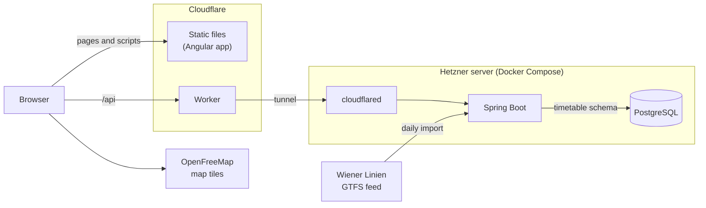

# Vienna Pulse

[](https://github.com/vlad-dancea/vienna-pulse-v2/actions/workflows/backend.yml)
[](https://github.com/vlad-dancea/vienna-pulse-v2/actions/workflows/frontend.yml)

A live map of the Vienna public transport network, built on the Wiener Linien GTFS feed. It shows
the stops, today's lines and the running vehicles where the timetable puts them right now.

| Folder | What it is |
| --- | --- |
| [`vienna-pulse-backend`](vienna-pulse-backend) | Spring Boot (Java 25): imports the GTFS feed into PostgreSQL every morning and serves stops, scheduled lines and scheduled vehicle positions as GeoJSON, and a stop's next departures as JSON |
| [`vienna-pulse-frontend`](vienna-pulse-frontend) | Angular 22 (TypeScript): a full-screen map of Vienna with stops, scheduled routes and the running vehicles |
| [`deploy`](deploy) | The production stack and how it is deployed |

## Architecture



### Frontend

The Angular app is a set of static files, which Cloudflare serves from its edge with Workers
Static Assets. A path outside `/api` that is not a file gets `index.html`, so Angular's router handles it. The
browser loads the base map from OpenFreeMap and everything about the network from `/api`. The
map is in [`map-view.ts`](vienna-pulse-frontend/src/app/map-view/map-view.ts).

### Cloudflare Worker

Only `/api` and `/api/*` run the [Worker](vienna-pulse-frontend/worker/index.ts), as configured in
[`wrangler.json`](vienna-pulse-frontend/wrangler.json). In production it passes the request on
unchanged, and Cloudflare sends it through the tunnel to the backend. A pull request Preview has
no tunnel of its own, so its Worker sends API requests to production.

### Tunnel and server

The backend runs on one Hetzner server as the Docker Compose stack in
[`deploy/compose.yaml`](deploy/compose.yaml): Spring Boot, PostgreSQL and cloudflared. cloudflared
connects out to Cloudflare, which forwards `pulse.vladdancea.com/api/*` to the backend over that
connection, so the server has no open ports to the internet. The database sits on an internal network without
internet access. Administrators and CI reach the server over Tailscale.

### Daily import

At 07:00 Vienna time, [`ImportJob`](vienna-pulse-backend/src/main/java/com/vladdancea/viennapulse/importer/ImportJob.java)
downloads the feed's ZIP file and checks that it has every file the importer needs. It streams
the routes, stops, shapes, trips, stop times, service calendars and their exceptions into a `staging` schema with
PostgreSQL's `COPY`. Then it classifies every platform by the modes of the trips that let
passengers board or alight there, and records when each trip leaves its first stop and reaches
its last. In the same transaction, [`Store`](vienna-pulse-backend/src/main/java/com/vladdancea/viennapulse/importer/store/Store.java)
renames `timetable` to `timetable_old` and `staging` to `timetable`. Readers see either the
previous timetable or the new one, never a mix, and a failed import leaves the previous one in
place. A failed import tries again after 10 minutes, 1 hour and 3 hours, then waits for the next
morning. The download stops at 500 MB.

Flyway migrations create the tables when the backend starts. A new database gets its first
import right after startup, and so does one where an upgrade added stop modes, stop times or
trip spans that are still empty.

### API

The [`api`](vienna-pulse-backend/src/main/java/com/vladdancea/viennapulse/api) package reads the
`timetable` schema and shares no code with the importer. The feed lists each platform as a stop
of its own, with ids like `at:49:1320:0:3`. The first three parts name the stop, and the API
merges a stop's platforms into one point in their middle, with the id `at:49:1320`.

| Endpoint | What it returns |
| --- | --- |
| `/api/stops` | Every stop as a GeoJSON point with its name and the modes that serve it. The modes are null while an upgrade waits for its first classification. |
| `/api/lines?date=YYYY-MM-DD` | The lines that run on the date, today in Vienna if left out, as GeoJSON paths along the shapes their trips follow, with the line's name, mode and colors. A date the timetable does not cover gets a 404. |
| `/api/vehicles` | A GeoJSON point for every trip running now, where its timetable puts it, with the trip id as feature id and the line, its colors and the headsign as properties. |
| `/api/stops/{id}/departures` | The next 20 departures from any platform of the merged stop, each with its time in Vienna, its line, its headsign and its platform. An unknown stop gets a 404. The map does not show the departures yet. |

A vehicle moves along its shape at an even speed between two stops and waits at a stop between
its arrival and departure. Trips without a shape, or without distances along it, are left out. The trip spans
the importer records find the running trips without reading every stop time.

Successful responses carry an ETag and `Cache-Control: no-cache`, so a browser asks again each time
and gets an empty 304 while nothing changed. Errors use the problem details format of RFC 9457.

## Run

The toolchain is managed by [mise](https://mise.jdx.dev): the root `mise.toml` pins the tool
versions for every project, and each project's `mise.toml` defines its own tasks. The backend
also needs [Docker](https://docs.docker.com/engine/install/): it starts its PostgreSQL database in
a container, and its tests start their own.

```bash
mise trust --all
mise run dev     # backend at http://localhost:8080, frontend at http://localhost:4200
mise run check   # the check task of every project, which CI runs too
mise run format  # format the sources of every project
```

mise installs the pinned tools on first use. The frontend installs dependencies from its
committed pnpm lockfile before its tasks run. In development, the Angular dev server forwards
`/api` to the backend on port 8080.

To run one project, use `mise run //vienna-pulse-frontend:dev` or
`mise run //vienna-pulse-backend:dev`. Each project has its own CI workflow running its
`check` task. The backend checks formatting, compiler warnings, Error Prone, NullAway and its
tests. The frontend checks formatting, typed ESLint rules, template accessibility, the
production build, Vitest tests and Cloudflare runtime integration tests. The backend's CI
workflow also packages the jar and builds the container image, which the local check does not.

[`AGENTS.md`](AGENTS.md) holds the instructions for coding agents, and `CLAUDE.md` points Claude
Code to it. `.mcp.json` and `.codex/config.toml` start the Angular CLI's MCP server for Claude
Code and Codex with the project's pinned CLI. Install its dependencies first with
`mise run //vienna-pulse-frontend:install`.

## Map view

The frontend shows Vienna's public transport stops, today's scheduled routes and the running
vehicles on a full-screen map. [MapLibre GL JS](https://maplibre.org) draws the map with
[OpenFreeMap](https://openfreemap.org)'s light Positron style, which needs no API key. Stops come
from `/api/stops` and routes from `/api/lines`, using today's service date in Vienna. The date
updates within a minute of midnight and when a suspended tab resumes. Lines use the feed's colors,
with fallback colors when none are supplied, and show their names at closer zoom levels.

Vehicles come from `/api/vehicles` every 15 seconds while the tab is visible, and again as soon
as it becomes visible. Each one is a dot in its line's color that glides at an even pace to its
next position over those 15 seconds, so the vehicles keep moving between two requests. With
reduced motion turned on, they jump instead. These are positions from the timetable, not live
ones.

The All, U-Bahn, Tram and Bus controls filter routes, vehicles and stops. Interchanges remain
visible for every mode that serves them. Stop modes cover the full imported timetable, while
routes run on today's service date. Stop loading and upgrade status appear in the map panel only
while needed, with a retry button when the stops request fails. While the backend is upgrading or
importing for the first time, the frontend keeps available stops visible and rechecks once a
minute until classifications arrive. The map keeps MapLibre's own mouse, touch and keyboard
controls.

Vienna's 23 Bezirke have dashed boundaries and numbered names, replacing the base map's
neighborhood labels inside and outside the city. Street, town and village names stay
visible above the boundaries. District names appear from zoom 12 and fade out between
zoom 14 and 15. Wider views show district numbers. The bundled geometry comes from
[Stadt Wien's district boundaries](https://www.data.gv.at/katalog/dataset/2ee6b8bf-6292-413c-bb8b-bd22dbb2ad4b/resource/f5ad0704-ceca-4c46-87f2-f2e131eee44b)
under [CC BY 4.0](https://creativecommons.org/licenses/by/4.0/).
Datenquelle: Stadt Wien - https://data.wien.gv.at.

The snapshot was downloaded on 2026-10-20, with source update date 2026-09-01. It is
simplified to a 5-meter interval and coordinates rounded to five decimal places. Label
anchors are interior points of the simplified polygons. To refresh both assets from the
repository root:

```sh
district_tmp=$(mktemp -d)
curl --fail --location 'https://data.wien.gv.at/daten/geo?service=WFS&request=GetFeature&version=1.1.0&typeName=ogdwien:BEZIRKSGRENZEOGD&srsName=EPSG:4326&outputFormat=json' -o "$district_tmp/districts.json"
mise exec -- pnpm dlx mapshaper@0.7.36 \
  -i "$district_tmp/districts.json" \
  -filter-fields BEZNR,NAMEK -rename-fields number=BEZNR,name=NAMEK \
  -simplify interval=5 keep-shapes \
  -o vienna-pulse-frontend/public/data/vienna-districts.geojson format=geojson precision=0.00001 \
  -points inner \
  -o vienna-pulse-frontend/public/data/vienna-district-labels.geojson format=geojson precision=0.00001
rm -r "$district_tmp"
```

## Deployment

The frontend runs at [pulse.vladdancea.com](https://pulse.vladdancea.com) on Cloudflare Workers
Static Assets. A merge to `main` that changes the frontend deploys it after the checks pass. One
that changes the backend or its production stack builds a container image with signed
provenance, which CI deploys to the server over Tailscale before it checks every API endpoint
through Cloudflare. A merge that changes neither, such as one to this README, deploys nothing. Each pull
request from a branch in this repository that changes the frontend gets a Preview at
`pr-<number>.pulse.vladdancea.com`. See [`deploy/README.md`](deploy/README.md) for credentials,
previews, manual deployments and rollback.
